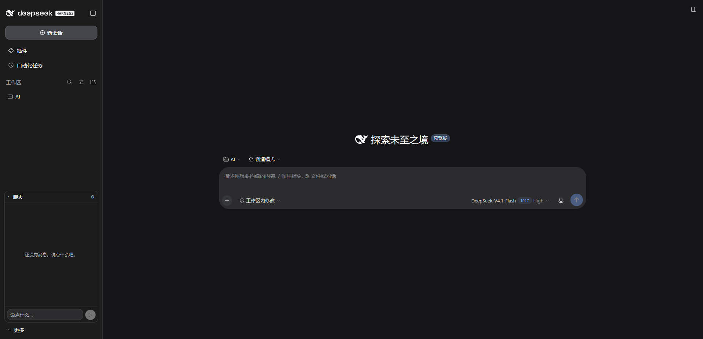
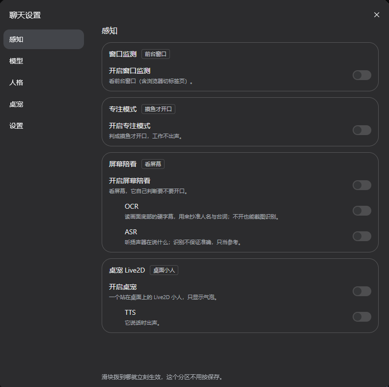

# dsh-chat-widget

DSH（DeepSeek Harness）侧边栏底部的常驻聊天栏：能聊天、会看屏幕，高兴了还能变成桌面上的 Live2D 小人。

> 非官方第三方插件，按现状发布（as-is）。适配 **DSH 0.2.1+**。
> 插件接口还是预览版，升级 DSH 后可能失效；本仓库不保证跟进更新。

<p align="center">
  
</p>

<p align="center">
  
  <br>
  <sub>桌宠角色「朝那玲」——模型与立绘随仓库提供，授权见 <a href="ASSETS.md">ASSETS.md</a>（保留所有权利，不可再分发 / 商用）</sub>
</p>

## 功能

### 聊天

- 常驻侧边栏底部，随时开口，不用打断正在跑的会话
- 流式回复、Markdown 渲染
- 本地记忆库（SQLite）：定时扫描入库，聊天时按相关度取回旧事
- 没有向量服务也能用：Embedding 选「BM25 关键词模式」即完全离线
- 人格写在 `soul.js` 里，可改

### 感知

- **窗口监测**：谁在前台、标题是什么（浏览器切标签页也算），由原生 C# 助手常驻轮询
- **专注模式**：判定为「摸鱼」才开口，工作状态不出声
- **屏幕陪看**：截图 + OCR 读画面里的硬字幕（人名、台词），ASR 听扬声器在说什么
- **桌宠 Live2D**：独立透明置顶窗口，会冒气泡、会说话，可拖动、可穿透

<p align="center">
  
</p>

### 模型

对话、视觉、Embedding 三个角色分别配置，支持：

- Ollama（默认 `http://127.0.0.1:11434`）
- OpenAI 兼容端点
- DeepSeek 官方 API
- OpenRouter

## 安装

```bat
dsh plugin --profile web add "<本目录的绝对路径>"
```

注册后**重启 `dsh web`**。profile 里记的是软链，移动目录后要重新 `add`。

## 前置条件

- **Windows 10/11**：截图、OCR、音频、窗口监测都由 C# 编译成 exe 运行
- .NET Framework 的 `csc.exe`（系统自带）；想要字幕 OCR 还需要 **Windows SDK** 的 `Windows.winmd`，缺了会自动退化成「无 OCR 的截图引擎」
- Node 侧依赖 `sherpa-onnx-node`（ASR 与本地 TTS），需在 DSH 安装目录中可解析

## 原生引擎与 Smart App Control

截图 / OCR / 音频 / 窗口监测用的是四个 C# 小引擎，源码在 [`native/`](native/)，
运行时编成 EXE（早期是运行时生成的 `.ps1`，会被 Defender 的 AMSI 判成恶意脚本）。

- **Smart App Control 没开**（默认状态）→ 第一次用到时用系统自带的 `csc.exe` 当场编译，约 0.4 秒，不联网
- **开着** → 它只放行签过名的程序，本机编的 EXE 会被拦掉。这时插件从本仓库的
  GitHub Release 下载**已签名**的预编译产物，逐个核对 `native-manifest.json` 里的 sha256；
  下载失败就退回本机编译，并在设置里 OCR / ASR / 窗口监测 三处说明原因，
  给一个跳到「Windows 安全中心 → 应用和浏览器控制」的入口

四个引擎都不联网、不写注册表、不提权，只做截图、OCR、录扬声器音轨、盯前台窗口这四件事。
构建与签名流程（由 [SignPath Foundation](https://signpath.org/) 提供签名）见 [docs/NATIVE.md](docs/NATIVE.md)。

## 桌宠

仓库里**自带一个角色：朝那玲**（`pet/assets/live2d/朝那玲/`），渲染库 `pixi.js` 与
`pixi-live2d-display` 也一起提供了。还缺的只有两样：

| 需要什么 | 怎么来 |
| --- | --- |
| `live2dcubismcore.min.js` | 第一次开启桌宠时插件会提示，点一下从 Live2D 官方地址下载（专有软件，不能随仓库分发） |
| Electron 运行时 | 首次开启桌宠时从 DSH 桌面端自动准备 |

想换自己的模型：把 `*.model3.json` 那套放进 `pet/assets/live2d/<名字>/`，重启后在设置里选。

> 「桃濑日和」是 Live2D 的官方示例模型，有版权、禁止再发布，所以仓库里没有，也不要往里放。
> 细节见 [pet/assets/README.md](pet/assets/README.md)。

## 隐私

- 屏幕、音频采集**默认全部关闭**，开关都在设置里
- 截图、OCR、ASR、本地 TTS 都在本机完成
- 开启「屏幕陪看」后，截图会发给你配置的**视觉模型端点**；用本地 Ollama 就不出网
- 默认 TTS 引擎是 `edge`，会把要朗读的文字发到微软的在线朗读服务；不想出网就换 `kokoro` / `melo`
- 对话和记忆都存在本机 `~/.dsh/chat-widget/`

## 已知限制

- 仅 Windows
- 没有 Windows SDK 时 OCR 不可用（截图和视觉理解仍可用）
- OCR / ASR 的识别结果只作参考，不保证准确
- Smart App Control 开着、又没下到签名产物时，四个引擎都跑不起来（设置里会说明原因并给出入口）

## 许可

分两部分，别混：

| 内容 | 许可 |
| --- | --- |
| 代码（`index.js`、`client.js`、`host/`、`native/`、`pet/*.js` …） | [MIT](LICENSE) |
| 角色「朝那玲」的模型与立绘（`pet/assets/live2d/朝那玲/`、`docs/character.png`） | **保留所有权利**，不可再分发、不可商用，详见 [ASSETS.md](ASSETS.md) |

仓库不包含 Live2D Inc. 的任何素材（桃濑日和、Cubism Core 均不在内）。
